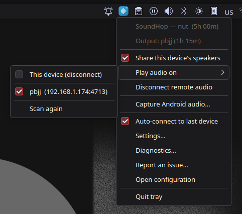
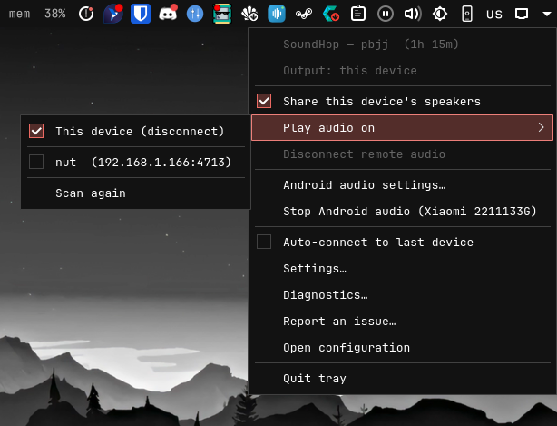
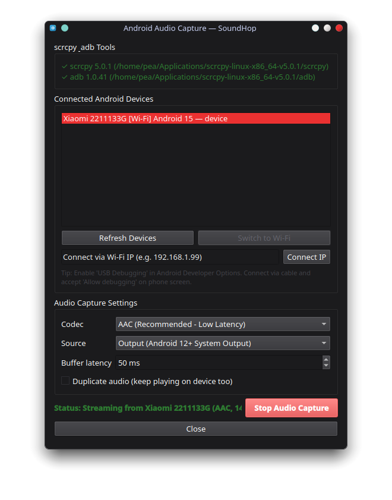
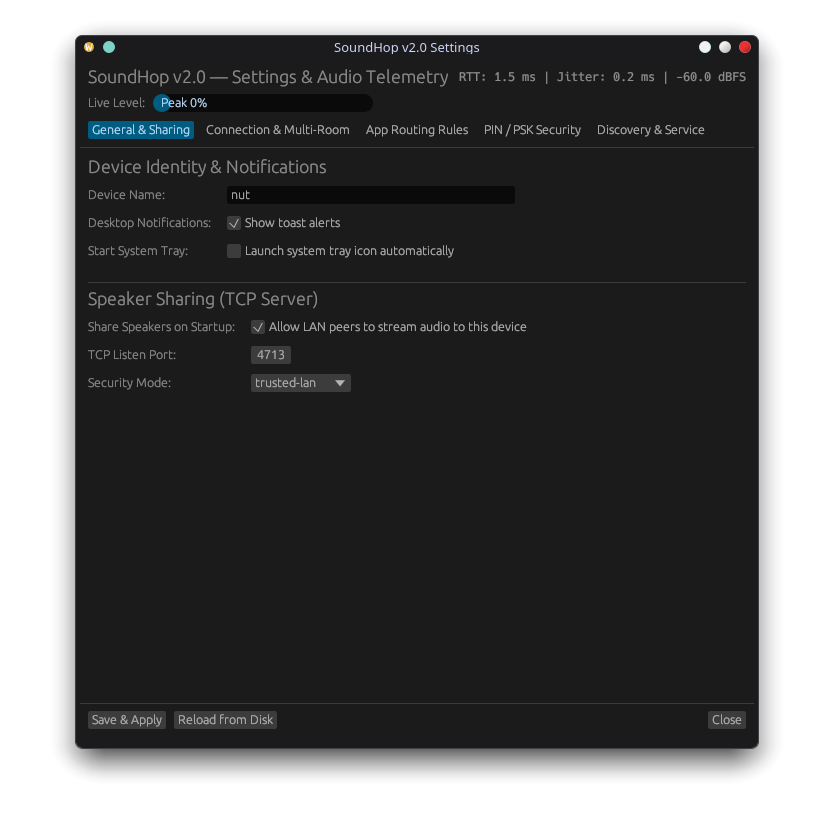

# 🔊 SoundHop

> Hop audio between Linux boxes on your local network without manual `pactl` plumbing or broken streams.

[](https://github.com/teufortressIndustries/soundhop/actions/workflows/ci.yml)
[](LICENSE)

[**Download Latest AppImage (Releases)**](https://github.com/teufortressIndustries/soundhop/releases) • [**Quickstart**](#quickstart) • [**CLI Commands**](#cli-command-reference) • [**Requirements**](#requirements) • [**Building from Source**](#building-from-source) • [**How It Works**](#how-it-works-under-the-hood)

---

Ever wanted to stream audio from your laptop to your desktop speakers across the room, or beam audio from a workstation to an HTPC hooked up to your sound system?

PulseAudio and PipeWire already implement native TCP network streaming modules (`module-native-protocol-tcp` and `module-tunnel-sink`), but setting them up by hand is tedious:
- Manually looking up peer LAN IP addresses and remembering raw `pactl load-module` arguments.
- Handling firewall rules (`4713/tcp`, `47777/udp`).
- Live audio streams not automatically moving over when a tunnel connects.
- Ghost tunnels and frozen audio when a remote laptop suspends or Wi-Fi drops.

**SoundHop** fixes this. It wraps PipeWire and PulseAudio in an automatic, self-healing workflow with zero-configuration LAN discovery, an intuitive desktop system tray for KDE Plasma and GNOME (**the preferred and easiest way to use SoundHop**), and a full-featured CLI (`soundhop` or the short alias `shop`) for headless environments and scripts.

---

## Quickstart

The primary and recommended way to use SoundHop is through the native desktop system tray widget. It runs seamlessly on KDE Plasma, GNOME, and other Linux desktop environments.

### 1. Launch SoundHop
Download and run the standalone **[SoundHop AppImage](https://github.com/teufortressIndustries/soundhop/releases)** (no installation needed) or run:
```bash
soundhop tray
```
*(Or launch **SoundHop** directly from your desktop application launcher)*.

### 2. Receiver (e.g. your PC or sound system with good speakers)
Click the SoundHop tray icon and check **Share this device's speakers**.

### 3. Sender (e.g. your laptop)
Click the SoundHop tray icon, hover over **Play audio on**, and select your target machine (e.g. `pbjj (192.168.1.174:4713)`).
Active playback streams (Spotify, Firefox, mpv, games) immediately switch over to the remote speakers.

To stop streaming and restore audio back to local speakers or headphones at any time, click **Play audio on > This device (disconnect)** or **Disconnect remote audio**.

| Sender (Laptop — Fedora KDE) | Receiver (PC — CachyOS KDE) |
| :---: | :---: |
|  |  |
| *Laptop (`nut`) playing audio remotely on `pbjj (192.168.1.174:4713)`* | *PC (`pbjj`) sharing its speakers with **Share this device's speakers** enabled* |

### Android Audio Streaming & GUI Settings

SoundHop also provides dedicated GUI dialogs accessible directly from the tray menu:

| Android Audio Capture | Preferences & Audio Buffer Tuning |
| :---: | :---: |
|  |  |
| *Stream mobile audio via USB or Wi-Fi with configurable codecs, audio sources & latency* | *Configure device identity, buffer latency presets, and LAN security* |

- **Capture Android audio...**: Effortlessly stream Android audio directly to your Linux speakers using official `scrcpy` over USB or Wi-Fi. Select your preferred codec (AAC, Opus, FLAC, Raw PCM), audio source (system output, app playback, or mic), and buffer latency.
- **Settings...**: Customize your broadcast device name, audio port, RFC1918 subnet security, PipeWire buffer latency presets, automatic stream handoff, and scrcpy defaults.

---

## Headless & CLI Usage

Prefer working from the terminal, running on a headless server, or scripting integrations for Waybar or Polybar? SoundHop provides a first-class CLI (`soundhop` or `shop`):

### 1. Receiver (PC / Sound System)
Turn on audio sharing:
```bash
soundhop share on
```
*(If you have an active firewall like firewalld or ufw, run `soundhop firewall open`)*.

### 2. Sender (Laptop / Workstation)
Connect and pick the target machine:
```bash
soundhop connect
```
```text
Discovered devices:
  1) pbjj (192.168.1.174:4713) [LAN]
Select device [1]: 1
✓ Audio is now playing on pbjj.
```

### 3. Disconnect
```bash
soundhop disconnect
```
Audio falls straight back to your local speakers or headphones without missing a beat.

---

## What's New in v2.0 (Pure Rust Rewrite)

SoundHop v2.0 is a ground-up rewrite in pure Rust (`soundhop-core`, `soundhop-gui`, `soundhop-cli`), eliminating the Python & Qt runtime overhead while introducing five flagship capabilities:

1. **Interactive Terminal UI (`soundhop tui` / default when run with no args in a TTY)**: Live `ratatui` dashboard with Multi-Room peer toggles, Per-App Audio Mixer, Mic & Android Bridge controls, and a real-time stereo VU meter + network RTT/jitter bar.
2. **Multi-Room / Simultaneous Broadcast Audio (`soundhop connect PeerA PeerB --combine --keep-local`)**: Stream audio to multiple LAN speakers at once (plus optionally keep your local speakers playing in sync) via `module-combine-sink` on Linux and multi-peer TCP fan-out on Windows.
3. **Persistent Per-App Routing Rules (`soundhop route Spotify --save`)**: Save `always_remote` and `always_local` application rules in `config.toml` (`[routing]`) so your music player automatically hops to remote speakers while system alerts or browsers stay local.
4. **PIN / Pre-Shared Key (PSK) Pairing & HMAC-SHA256 Authentication (`soundhop pair <peer> --pin 123456`)**: Cryptographically sign UDP discovery beacons with HMAC-SHA256 and deterministically synchronize a 256-byte PulseAudio auth cookie across paired machines.
5. **Real-Time Audio Level Meter & Network Latency / Jitter Telemetry**: Live Peak/RMS/dBFS audio metering and rolling TCP/UDP RTT & jitter (`ms`) tracking in both the TUI and the `egui` Settings dialog.

---

## Requirements

| Component | Minimum Version | Notes |
| :--- | :--- | :--- |
| **Linux / Windows** | Linux 5.x+ / Windows 10+ | Native static/dynamic Rust binaries (`soundhop` & `shop`) |
| **Audio Server** | PipeWire 0.3+ / PulseAudio 14+ / WASAPI | `pactl` on Linux; native WASAPI loopback & playback on Windows |
| **Rust Toolchain** | `rustc` / `cargo` 1.80+ | Only required when building from source |

---

## How It Works (Under the Hood)

```
┌────────────────────────────────┐         LAN UDP :47777         ┌────────────────────────────────┐
│         Sender Device          │ ◄────────────────────────────► │        Receiver Device         │
│     (e.g. Laptop / PC)         │       (Zero-Config Beacon)     │   (e.g. PC / Speakers / HTPC)  │
│                                │                                │                                │
│  • soundhop daemon             │                                │  • soundhop daemon             │
│  • module-tunnel-sink          │ ═════════════════════════════► │  • module-native-protocol-tcp  │
│  • Auto-routes active streams  │      Raw TCP PCM Audio :4713   │  • Subnet ACL (192.168.x.x)    │
└────────────────────────────────┘                                └────────────────────────────────┘
```

1. **Discovery**: Each node runs a tiny background supervisor. When sharing is enabled, it broadcasts a JSON beacon over UDP port `47777` (with automatic mDNS `_soundhop._tcp` fallback). Peers discover each other in under two seconds.
2. **Audio Transport**: Native PCM audio travels over TCP port `4713`. Sender loads `module-tunnel-sink` specifying `rate=48000 channels=2 format=s16le` to eliminate software resampling degradation.
3. **Stream Handover**: SoundHop inspects active sink-inputs (`pactl list sink-inputs`) and moves running audio apps onto the remote sink, setting it as default.
4. **Resilience & Sleep Supervision**: If the receiving device goes to sleep, closes its lid, or drops off Wi-Fi, the supervisor senses TCP timeout, cleanly unloads the dead tunnel, and restores sound to your local output. Once the receiver wakes back up, SoundHop can automatically reconnect.
5. **DSP Awareness**: SoundHop checks for active DSP suites like **EasyEffects**, **JamesDSP**, and **NoiseTorch** to warn if virtual sink re-routing could add unintended latency.

---

## CLI Command Reference

Both `soundhop` and its single-syllable alias `shop` are available.

### Everyday Commands
```bash
soundhop status                 # Show current connection, sharing status, discovered peers, and sinks
soundhop status --json          # Raw JSON output for Waybar, Polybar, or scripts
soundhop discover               # Scan LAN for online SoundHop nodes
soundhop connect [name|ip]      # Connect interactively or directly by hostname / IP
soundhop connect --with-mic     # Connect and enable microphone pass-through
soundhop connect --host 192.168.1.50 --port 4713
soundhop disconnect             # Drop remote tunnel and restore local sound output
soundhop share <on|off|status>  # Enable or disable receiving audio from other devices
soundhop tray                   # Launch Qt system tray icon (KDE Plasma / GNOME)
```

### Stream Routing, Mic Pass-Through & Volume Sync
```bash
soundhop apps                   # List active audio applications and stream routing
soundhop route spotify          # Route Spotify to remote speakers
soundhop route firefox --local  # Keep Firefox audio playing on local speakers
soundhop unroute spotify        # Return Spotify to default output
soundhop mic <on|off|status>    # Toggle or check remote microphone pass-through
soundhop volume                 # Show volume and mute status with remote sync
soundhop volume 80              # Set output volume to 80% (syncs to remote receiver)
soundhop volume mute            # Mute output
```

### Android Audio Capture (scrcpy)
Capture and stream audio from Android devices directly to your Linux speakers over Wi-Fi or USB.
```bash
soundhop android                # Interactive setup wizard & device pairing
soundhop android 192.168.1.99   # Connect directly to a specific phone IP or serial
soundhop android history        # View paired Android device connection history
soundhop android clear-history  # Clear device history
soundhop android stop           # Stop running audio capture session
soundhop android status         # Show scrcpy / adb tool paths and active sessions
soundhop android devices        # List detected Android devices and Android versions
soundhop android encoders       # List hardware/software audio encoders supported by your phone
soundhop android wifi           # Switch a plugged-in USB phone to wireless Wi-Fi mode
soundhop android install        # Download & install standalone official scrcpy (zero-bloat, on-demand)
```

### Automation & Services
```bash
soundhop auto <on|off>          # Toggle automatic reconnection to your last paired machine
soundhop auto pause             # Temporarily pause auto-reconnect (e.g. while on public Wi-Fi)
soundhop auto resume            # Resume auto-reconnect
soundhop service install        # Install and enable systemd user unit (soundhop.service)
soundhop service status         # Check systemd service status
soundhop service restart        # Restart user daemon
```

### Diagnostics & Network
```bash
soundhop doctor                 # Self-test PipeWire/PulseAudio, sockets, pactl, and firewalls
soundhop bug-report             # Dump sanitized markdown diagnostics for GitHub issues
soundhop bug-report --open      # Generate report and open pre-filled GitHub issue in browser
soundhop firewall <open|close|status> # Manage rules for firewalld (Fedora) or ufw (Ubuntu)
```

### Shell Completions
Tab completion is available for Bash, Zsh, and Fish:
```bash
# Fish (CachyOS / Arch default):
soundhop completions fish > ~/.config/fish/completions/soundhop.fish

# Bash:
soundhop completions bash > ~/.local/share/bash-completion/completions/soundhop

# Zsh:
soundhop completions zsh > ~/.zsh/completion/_soundhop
```

---

## Building from Source

If you want to hack on SoundHop or build from git:

### 1. Clone repository
```bash
git clone https://github.com/teufortressIndustries/soundhop.git
cd soundhop
```

### 2. Build release binaries with Cargo
```bash
cargo build --release --workspace
# Binaries are emitted to target/release/soundhop and target/release/shop
```

### 3. Run unit & integration tests
```bash
cargo fmt --all -- --check
cargo clippy --workspace --all-targets -- -D warnings
cargo test --workspace
```

### 4. Build Universal AppImage locally
```bash
./packaging/build-appimage.sh
```
The finished binary will be placed at `dist/SoundHop-2.0.0-universal-x86_64.AppImage`.

---

## Configuration & Tuning

Configuration is stored in `~/.config/soundhop/config.toml` (and can be edited directly or through `soundhop config set <key> <val>`):

```toml
[device]
name = "Fedora-Desktop"          # Display name broadcasted to other devices

[sharing]
enabled = false                 # Whether this device accepts incoming audio
security = "trusted-lan"        # "trusted-lan" (RFC1918 subnets), "cookie" (auth cookie), or "open"

[connection]
auto_connect = true             # Automatically reconnect to last paired device when seen
disconnect_on_quit = true       # Drop remote tunnel and restore local audio when tray app exits
latency_ms = 0                  # 0 = automatic default (or 50 for low-latency, 100 balanced, 200 Wi-Fi buffer)

[discovery]
port = 47777                    # UDP broadcast discovery port
mdns = true                     # Enable mDNS fallback browsing
```

*(SoundHop automatically tracks your hardware outputs and restores audio to your previous default sink on disconnect).*

---

## Limitations & Honest Notes

- **Supported Platforms**: Linux (PipeWire / PulseAudio) and Windows 10/11 (WASAPI / sounddevice). macOS is currently not supported.
- **Platform Feature Matrix**:
  - **LAN Speaker Streaming & Discovery**: Supported on both Linux and Windows 10/11.
  - **Android Audio Capture (`scrcpy`)**: Supported on both Linux and Windows 10/11 (virtual microphone mode requires Linux).
  - **Per-Application Stream Routing, Microphone Pass-Through & Remote Volume Sync**: Supported on Linux (PipeWire / PulseAudio) only.
- **LAN-oriented**: Designed for local Wi-Fi, Ethernet, and peer-to-peer networks. If you want to stream across the open Internet, run over [Tailscale](https://tailscale.com) or WireGuard.
- **ALSA-only systems**: If your Linux setup does not run PipeWire or PulseAudio, SoundHop will not work.

---

## Roadmap

- [x] **v1.0**:
  - PipeWire & PulseAudio TCP audio transport
  - Fast UDP + mDNS LAN discovery
  - Native Wayland + X11 Qt system tray GUI
  - Full CLI (`soundhop` / `shop`) and shell autocompletions
  - Disconnect-on-quit toggle, buffer latency presets, and DSP detection (EasyEffects)
  - Portable AppImage & containerized multi-distro build pipeline
- [x] **v1.1**:
  - **Android Support (scrcpy)**: Capture and listen to the audio from your Android devices over USB or Wi-Fi.
  - **Windows Support (EXPERIMENTAL)**: Experimental support for Windows OS.
- [x] **v1.2 (Current)**:
  - **Per-Application Stream Routing**: Direct specific apps (e.g. Spotify or Firefox) to remote speakers without moving your whole desktop audio.
  - **Microphone Pass-Through**: Stream microphone input back to the sender for remote calls and Discord.
  - **Remote Volume Sync**: Control receiver volume directly from the sender's media keys.
  - **Android Auto-Discovery & History**: ZeroConf mDNS discovery for Android Wireless Debugging and persistent device history for 1-click reconnects.

---

## License

[MIT](LICENSE) © SoundHop Contributors.
