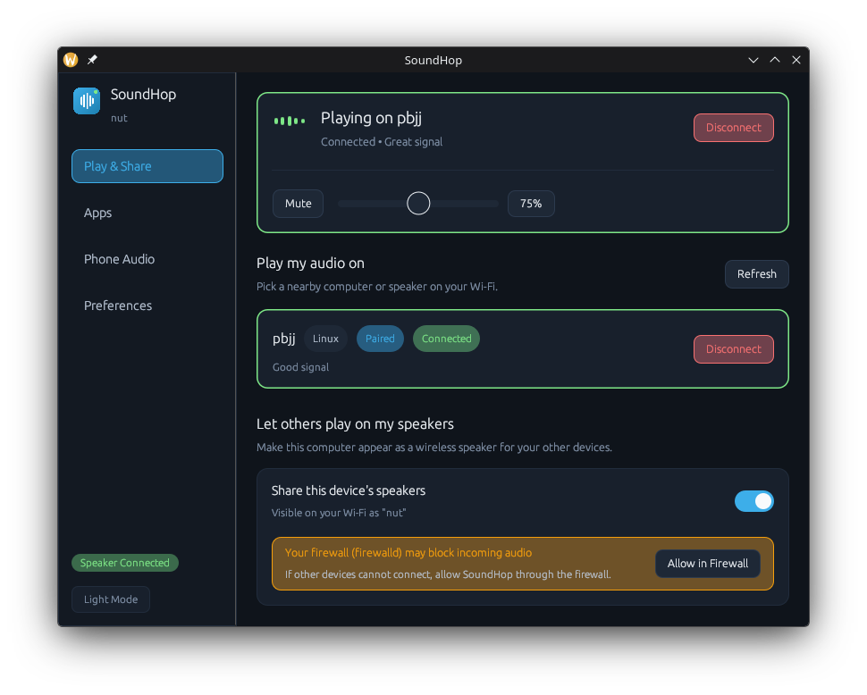
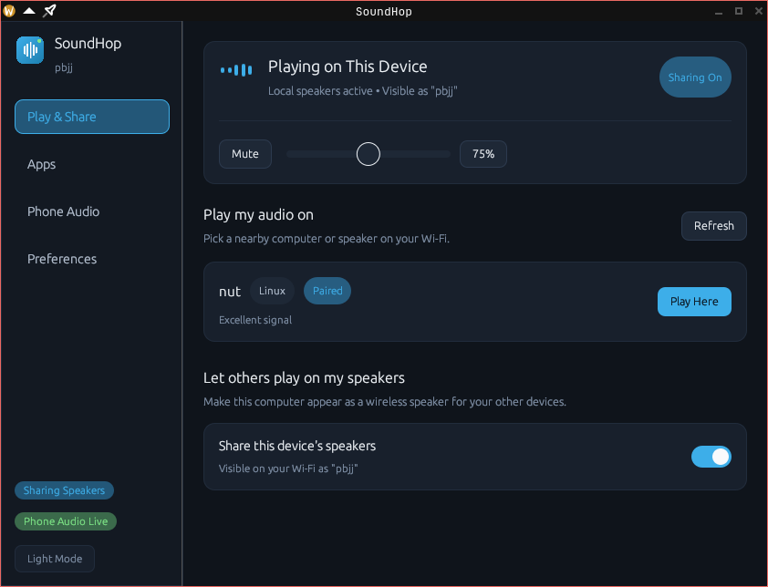
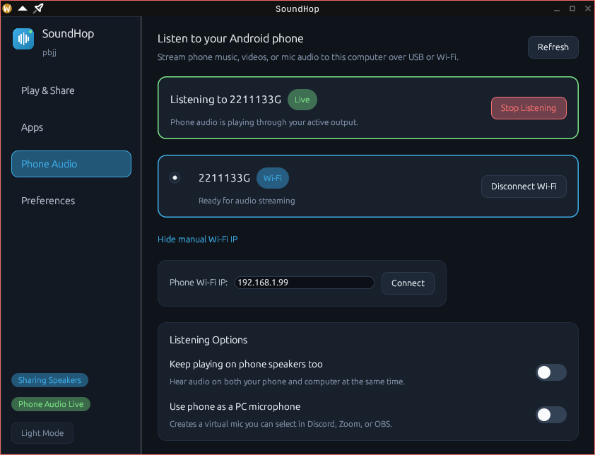
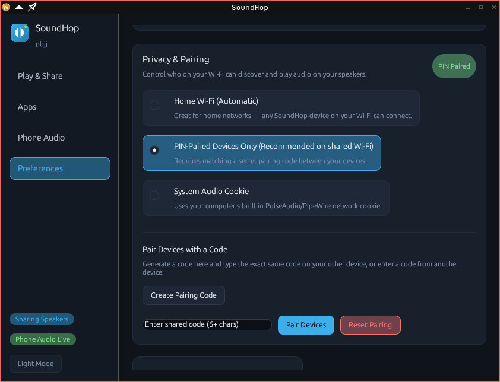
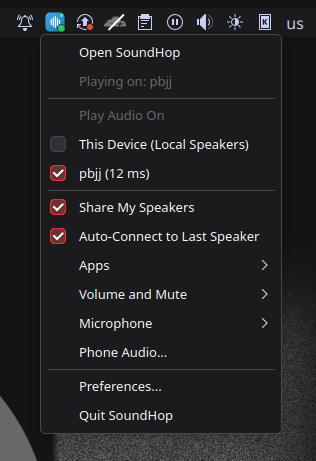
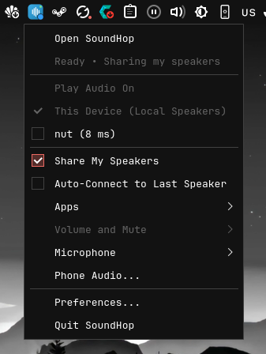
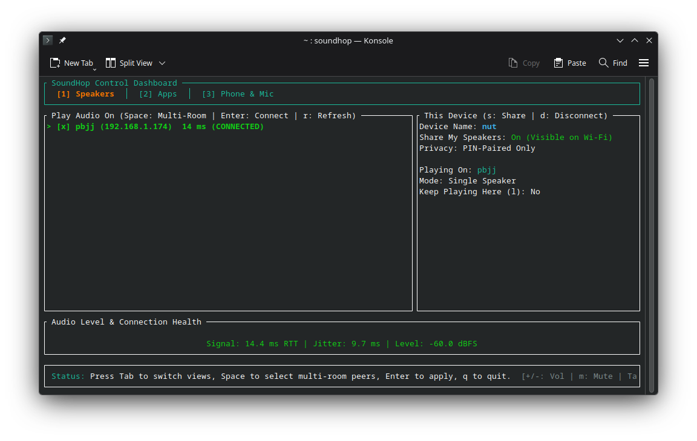

[](https://github.com/teufortressIndustries/soundhop/actions/workflows/ci.yml)
[](LICENSE)
[](https://pkgforge-dev.github.io/Anylinux-AppImages/)

#  SoundHop

[**Download Latest Release**](https://github.com/teufortressIndustries/soundhop/releases) • [**Quickstart**](#quickstart) • [**Windows Installation & Usage**](#windows-installation--usage) • [**Control Center & Tray**](#control-center-gui--system-tray) • [**Interactive TUI**](#interactive-terminal-ui-tui) • [**CLI Commands**](#cli-command-reference) • [**Requirements**](#requirements) • [**Building from Source**](#building-from-source) • [**How It Works**](#how-it-works-under-the-hood)

---

Ever wanted to stream audio from your laptop to your desktop speakers across the room, broadcast music to multiple rooms at once, or turn your computer into a wireless speaker for another device or Android phone?

PulseAudio and PipeWire already implement native TCP network streaming modules (`module-native-protocol-tcp` and `module-tunnel-sink`), but setting them up by hand is tedious:
- Manually looking up peer LAN IP addresses and remembering raw `pactl load-module` arguments.
- Handling firewall rules (`4713/tcp`, `47777/udp`, mDNS `5353/udp`).
- Live audio streams not automatically moving over when a tunnel connects.
- Ghost tunnels and frozen audio when a remote laptop suspends or Wi-Fi drops.

**SoundHop** fixes this. Written in pure Rust, it wraps PipeWire / PulseAudio (and Windows WASAPI/`cpal`) in an automatic, self-healing workflow with zero-configuration LAN discovery, a unified **Control Center GUI** (`soundhop gui`) paired with a native **desktop system tray** (`soundhop tray`), a live **Terminal UI** (`soundhop tui`), and a full-featured **CLI** (`soundhop`) for headless environments and scripts.

---

## Quickstart

The primary and recommended way to use SoundHop is through the **Control Center GUI** and **native desktop system tray**, which run seamlessly on KDE Plasma, GNOME, and other Linux desktop environments (as well as Windows 10/11).

### 1. Launch SoundHop
- **Linux**: Download and run the standalone **[SoundHop AnyLinux AppImage](https://github.com/teufortressIndustries/soundhop/releases)** (no installation, host libraries, or FUSE required — works on glibc, musl, and non-FHS distros) or run `soundhop gui`.
- **Windows 10/11**: Download the **[Windows Installer (`SoundHop-<version>-windows-x86_64-setup.exe`)](https://github.com/teufortressIndustries/soundhop/releases)** or the **[Portable ZIP (`SoundHop-<version>-windows-x86_64-portable.zip`)](https://github.com/teufortressIndustries/soundhop/releases)** and launch **SoundHop** (`soundhop-gui.exe`). See [Windows Installation & Usage](#windows-installation--usage) for details.

```bash
soundhop gui
```
*(Or launch **SoundHop** directly from your desktop application launcher / Start Menu. On first run, a guided 3-step onboarding wizard helps you set your device name, speaker sharing role, firewall rules, and login autostart. Running `soundhop gui` or `soundhop-gui.exe` automatically ensures the background system tray & daemon are running.)*

### 2. Receiver (e.g. your PC or sound system with good speakers)
Open **Play & Share** in the Control Center (or click the SoundHop tray icon) and enable **Share this device's speakers** (or **Share My Speakers** in the tray).

### 3. Sender (e.g. your laptop)
In **Play & Share**, click **Play Here** next to your target speaker (e.g. `pbjj`), or open the tray menu and select it under **Play Audio On**.
Active playback streams (Spotify, Firefox, mpv, games) immediately switch over to the remote speakers.

To stop streaming and restore audio back to local speakers or headphones at any time, click **Disconnect** in the Control Center or select **This Device (Local Speakers)** in the tray menu.

---

## Windows Installation & Usage

SoundHop provides first-class native Windows 10/11 (x86_64) packages on the [GitHub Releases](https://github.com/teufortressIndustries/soundhop/releases) page, alongside `SHA256SUMS.txt` for verification:

### Installation Options
- **Windows Installer (`SoundHop-<version>-windows-x86_64-setup.exe`)** *(Recommended)*:
  - Installs **per-user by default** (`%LOCALAPPDATA%\Programs\SoundHop`) with no administrator UAC prompt required; you can also choose an **all-users** install (`C:\Program Files\SoundHop`) in the setup dialog.
  - Creates a **SoundHop** Start Menu shortcut (`soundhop-gui.exe`), plus optional tasks for a **Desktop shortcut**, **Start SoundHop when Windows starts**, and **Add CLI (`soundhop.exe`) to user PATH**.
  - Gracefully closes any running SoundHop instance before upgrading or uninstalling, and cleanly removes the PATH entry, `HKCU Run` autostart entry, and (when uninstalled elevated) Windows Defender Firewall rules.
- **Portable ZIP (`SoundHop-<version>-windows-x86_64-portable.zip`)**:
  - Extract anywhere and run `soundhop-gui.exe` (or `soundhop.exe` from PowerShell/Terminal) with no installer or registry changes required.

### Dual Windows Binaries (`soundhop-gui.exe` vs `soundhop.exe`)
Windows packages include two executables so desktop and terminal workflows both behave natively:
- **`soundhop-gui.exe`**: Built with the Windows GUI subsystem (`windows_subsystem = "windows"`). Launches the Control Center GUI and system tray (`soundhop-gui.exe tray`) with **zero console window flash**, PerMonitorV2 High-DPI scaling, and native Win32 icons.
- **`soundhop.exe`**: Standard console subsystem binary for the CLI and interactive TUI (`soundhop tui`, `soundhop status`, `soundhop connect`, `soundhop doctor`, etc.).

### Windows Platform Notes
- **WASAPI Loopback & Playback**: On Windows, SoundHop uses native WASAPI (`cpal`) loopback capture to stream your system's default audio output over TCP (`48 kHz`, stereo `s16le`, with automatic resampling and device hotplug recovery when unplugging headphones or switching outputs). Because WASAPI loopback captures the active output device as a whole, per-application stream routing and microphone pass-through remain Linux-only (PipeWire/PulseAudio).
- **Windows Defender Firewall (UAC Prompt)**: To receive audio from other devices on your LAN, Windows Defender Firewall must allow inbound TCP `4713` (audio), UDP `47777` (LAN discovery), and UDP `5353` (mDNS). Clicking **Allow in Firewall** in the Control Center or running `soundhop firewall open` automatically triggers a Windows **UAC elevation prompt** to add scoped `private,domain` firewall rules cleanly.
- **Login Autostart (`HKCU Run`)**: Enabling **Start SoundHop when I log in** in Preferences, running `soundhop service install`, or selecting the installer's startup option registers `"<install-dir>\soundhop-gui.exe" tray` under `HKCU\Software\Microsoft\Windows\CurrentVersion\Run\SoundHop`. Disabling it in Preferences, running `soundhop service uninstall`, or uninstalling SoundHop removes the registry entry cleanly.

---

## Control Center GUI & System Tray

SoundHop v2.1 introduces the unified **Control Center** (`soundhop gui`) alongside an upgraded **System Tray** (`soundhop tray`) with live RTT latency readouts, status-badged icons, and Dark/Light/System themes.

### Control Center (`soundhop gui`)

| Sender (Laptop — Playing on `pbjj`) | Receiver (PC — Sharing Speakers & Phone Audio) |
| :---: | :---: |
|  |  |
| *Laptop (`nut`) streaming to `pbjj` with master volume slider, live wave indicator, and firewall helper* | *PC (`pbjj`) with **Share this device's speakers** active and `Phone Audio Live` status badge* |

The Control Center is organized into four sidebar views:
- **Play & Share**: View your active output & master volume/mute bar, connect to one or multiple LAN speakers (**Multiple speakers** multi-room mode with optional local playback), connect manually by IP/hostname, toggle **Share this device's speakers** (with one-click **Allow in Firewall** detection), and switch network microphone pass-through.
- **Apps**: Switch between **Send all apps** and **Only picked apps** default routing, toggle individual playing apps between remote and local output on the fly, and save permanent rules with **Always Remember**.
- **Phone Audio**: Stream audio from Android devices over USB or Wi-Fi using official `scrcpy` (installed on-demand in one click, SHA-256 verified), switch USB devices to wireless ADB, connect by manual Wi-Fi IP, optionally keep audio playing on phone speakers, or expose the phone as a virtual PC microphone (`SoundHop_Android_Mic`).
- **Preferences**: Switch between **Dark**, **Light**, and **System** themes, rename your device, toggle **Auto-connect** and **Start SoundHop when I log in**, manage **Privacy & Pairing** (**Home Wi-Fi**, **PIN-Paired Devices Only**, or **System Audio Cookie**) with a built-in pairing code generator, and expand **Advanced Audio, Network & Diagnostics** for buffer latency presets (`50 ms` / `150 ms` / `300 ms`), ports, live RTT/jitter/dBFS telemetry, and replaying the welcome tour.

| Phone Audio (`scrcpy` Android Bridge) | Preferences & Privacy Pairing |
| :---: | :---: |
|  |  |
| *Live Wi-Fi Android audio capture with manual IP connect, duplicate playback, and virtual PC mic toggles* | *Privacy modes and PIN/PSK device pairing with 12-character code generator* |

### System Tray (`soundhop tray`)

| Sender Tray Menu (`nut` → `pbjj`) | Receiver Tray Menu (`pbjj` Sharing) |
| :---: | :---: |
|  |  |
| *Green badge & checked `pbjj (12 ms)` under **Play Audio On**, with quick submenus for Apps, Volume, Mic, and Phone Audio* | *Blue badge (`Ready • Sharing my speakers`) showing `Share My Speakers` active and `nut (8 ms)` available* |

- **Dynamic Tray Status Badges**: Color-coded icon badge indicates Idle (no badge), Sharing (blue), Connected (green), Multi-Room (purple), or Error (red).
- **Quick Controls**: Open the Control Center (`Open SoundHop`), switch speakers or toggle **Multiple Speakers**, route per-app audio, adjust volume/mute, toggle microphone pass-through, or jump straight to **Phone Audio...** and **Preferences...**.
- **Seamless AppImage Upgrades**: Launching a newer SoundHop AppImage automatically replaces any stale background daemon/tray/GUI instance across versions, updates existing `systemd` user service (`soundhop.service`) and XDG autostart (`soundhop-tray.desktop`) paths to the new AppImage, and shows a confirmation toast in the GUI.

---

## Interactive Terminal UI (TUI)

Prefer managing audio from your terminal, running on a headless workstation over SSH, or keeping a live dashboard in a tmux pane? SoundHop features a rich terminal interface powered by `ratatui` and `crossterm`:

```bash
soundhop tui
```
*(Launching `soundhop` with no arguments in any interactive terminal opens the TUI automatically).*


*SoundHop Control Dashboard (`soundhop tui`) with live LAN peer discovery, multi-room selection, active device/privacy status, and real-time RTT/jitter + audio dBFS telemetry.*

- **Tab 1 (`[1] Speakers`)**: Navigate with arrow keys or `j`/`k`, press `Space` to select multiple speakers for simultaneous multi-room broadcast, `l` to toggle local speakers in sync, `Enter` to connect, `d` to disconnect, `s` to toggle sharing, and `r` to refresh.
- **Tab 2 (`[2] Apps`)**: Route individual applications (`Spotify`, `Firefox`, `mpv`) between remote and local sinks on the fly, or press `p` to save permanent routing rules to `config.toml`.
- **Tab 3 (`[3] Phone & Mic`)**: Toggle bi-directional microphone pass-through (`s` to stream mic, `r` to receive peer mic, `o` to stop) or start/stop Android audio capture (`a`).
- **Audio Level & Connection Health**: Bottom bar displays continuous network round-trip time (RTT) and jitter in milliseconds alongside real-time audio level in dBFS (`+`/`-` for volume, `m` to mute).

---

## Headless & CLI Usage

Prefer working from the terminal, running on a headless server, or scripting integrations for Waybar or Polybar? SoundHop provides a first-class CLI (`soundhop`):

### 1. Receiver (PC / Sound System)
Turn on audio sharing:
```bash
soundhop share on
```
*(If you have an active firewall like firewalld or ufw, run `soundhop firewall open`, or run `soundhop setup` for guided first-time setup).*

### 2. Sender (Laptop / Workstation)
Connect and pick the target machine:
```bash
soundhop connect
```
```text
Discovered devices:
  1) pbjj (192.168.1.174:4713) [LAN]
Select device [1]: 1
✓ Audio is now playing on pbjj.
```

### 3. Disconnect
```bash
soundhop disconnect
```
Audio falls straight back to your local speakers or headphones without missing a beat.

---

## What's New in v2.x (Pure Rust Rewrite & v2.1 Control Center)

SoundHop v2.x is a ground-up rewrite in pure Rust (`soundhop-core`, `soundhop-gui`, `soundhop-cli`), eliminating Python & Qt runtime overhead while introducing:

1. **Unified Control Center GUI (`soundhop gui`) & Onboarding (v2.1)**: Modern `egui` Control Center with 4 sidebar tabs (**Play & Share**, **Apps**, **Phone Audio**, **Preferences**), Dark/Light/System themes, guided 3-step first-run onboarding, upgraded tray integration, and automatic cross-version AppImage upgrade handoff & autostart/systemd path syncing.
2. **Interactive Terminal UI (`soundhop tui`)**: Live `ratatui` dashboard with Multi-Room peer toggles, App Mixer & persistent rules, Phone & Mic controls, and real-time audio dBFS + network RTT/jitter telemetry.
3. **Multi-Room / Simultaneous Broadcast Audio (`soundhop connect PeerA PeerB --combine --keep-local`)**: Stream audio to multiple LAN speakers at once (plus optionally keep your local speakers playing in sync) via `module-combine-sink` on Linux and multi-peer TCP fan-out on Windows.
4. **Persistent Per-App Routing Rules (`soundhop route Spotify --save`)**: Save `always_remote` and `always_local` application rules (plus `all` vs `selective` default mode) in `config.toml` (`[routing]`).
5. **Hardened PIN / Pre-Shared Key (PSK) Pairing & HMAC-SHA256 Auth (`soundhop pair`)**: 60,000-iteration PBKDF2-HMAC-SHA256 key derivation, 12-character pairing codes (or 6+ char custom codes), constant-time HMAC-SHA256 signed UDP discovery beacons, `0o600` 256-byte PulseAudio cookie & IPC socket permissions, and SHA-256 verified `scrcpy` tool downloads.
6. **Real-Time Audio Telemetry & AnyLinux Portability**: Live Peak/RMS/dBFS audio metering, rolling RTT & jitter tracking, and universal AnyLinux AppImages (`quick-sharun` + `uruntime`/DwarFS) running across glibc, musl, non-FHS, and non-FUSE Linux environments.

---

## Requirements

| Component | Minimum Version | Notes |
| :--- | :--- | :--- |
| **Linux / Windows** | Linux 5.x+ / Windows 10+ | Native static/dynamic Rust binary (`soundhop`) |
| **Audio Server** | PipeWire 0.3+ / PulseAudio 14+ / WASAPI | `pactl` on Linux; native WASAPI/`cpal` loopback & playback on Windows |
| **Rust Toolchain** | `rustc` / `cargo` 1.80+ | Only required when building from source |

---

## How It Works (Under the Hood)

```
┌────────────────────────────────┐         LAN UDP :47777         ┌────────────────────────────────┐
│         Sender Device          │ ◄────────────────────────────► │        Receiver Device         │
│     (e.g. Laptop / PC)         │       (Zero-Config Beacon)     │   (e.g. PC / Speakers / HTPC)  │
│                                │                                │                                │
│  • soundhop daemon             │                                │  • soundhop daemon             │
│  • module-tunnel-sink          │ ═════════════════════════════► │  • module-native-protocol-tcp  │
│  • Auto-routes active streams  │      Raw TCP PCM Audio :4713   │  • Subnet ACL / PSK / Cookie   │
└────────────────────────────────┘                                └────────────────────────────────┘
```

1. **Discovery**: Each node runs a lightweight background daemon. It broadcasts a JSON beacon over UDP port `47777` (with automatic mDNS `_soundhop._tcp.local.` fallback) and optionally signs beacons with HMAC-SHA256 when PIN/PSK pairing is enabled.
2. **Audio Transport**: Native PCM audio travels over TCP port `4713`. On Linux, the sender loads `module-tunnel-sink` specifying `rate=48000 channels=2 format=s16le` to avoid resampling degradation; on Windows, SoundHop uses native WASAPI/`cpal` loopback capture and TCP playback.
3. **Stream Handover**: SoundHop inspects active sink-inputs (`pactl list sink-inputs`) and moves running audio apps onto the remote sink (respecting `[routing]` rules), setting it as default when configured.
4. **Resilience & Sleep Supervision**: If the receiving device goes to sleep, closes its lid, or drops off Wi-Fi, the supervisor detects TCP timeout, cleanly unloads the dead tunnel, and restores sound to your local output. Once the receiver wakes back up, SoundHop can automatically reconnect.
5. **DSP Awareness**: SoundHop checks for active DSP suites like **EasyEffects**, **JamesDSP**, and **NoiseTorch** to warn if virtual sink re-routing could add unintended latency.

---

## CLI Command Reference

### Everyday & GUI Commands
```bash
soundhop                        # Open interactive TUI (when run in a terminal)
soundhop gui                    # Launch Control Center GUI (starts background tray if needed)
soundhop tray                   # Launch native OS system tray icon & background daemon
soundhop tui                    # Open interactive terminal UI dashboard
soundhop setup                  # Guided first-time CLI setup (name, sharing, firewall, service)
soundhop status                 # Show current connection, sharing status, peers, and telemetry
soundhop status --json          # Raw JSON output for Waybar, Polybar, or scripts
soundhop discover               # Scan LAN for online SoundHop nodes (with RTT latency)
soundhop connect [targets...]   # Connect interactively, by name/IP, or multi-room
soundhop connect PeerA PeerB --combine --keep-local
soundhop connect 192.168.1.50:4713 --latency 100 --remember
soundhop disconnect             # Drop remote tunnel / multi-room group and restore local sound
soundhop share <on|off|status>  # Enable or disable receiving audio from other devices
soundhop pair generate          # Generate a random 12-character pairing code
soundhop pair <peer> --pin CODE # Pair with a peer using a shared PIN/passphrase (6+ chars)
soundhop pair status            # Show pairing & security mode status (`clear` to reset)
```

### Stream Routing, Mic Pass-Through & Volume Sync
```bash
soundhop apps                   # List active audio applications and stream routing
soundhop route spotify          # Route Spotify to remote speakers
soundhop route spotify --save   # Persist always-remote routing rule in config.toml
soundhop route firefox --save --local  # Always keep Firefox audio on local speakers
soundhop unroute spotify        # Return Spotify to local speakers (`--all`, `--remove-rule`)
soundhop mic <send|receive|off|status> # Toggle or check network microphone pass-through
soundhop volume                 # Show volume and mute status with remote sync
soundhop volume 80              # Set output volume to 80% (`0-150`, `+10`, `-10`)
soundhop volume toggle          # Toggle mute (`mute`, `unmute`, `toggle`)
```

### Android Audio Capture (`scrcpy`)
Capture and stream audio from Android devices directly to your speakers over Wi-Fi or USB.
```bash
soundhop android wizard         # Open Android Audio Bridge UI (`gui`)
soundhop android install        # Download & verify standalone official scrcpy + adb (SHA-256)
soundhop android devices        # List detected Android devices via ADB
soundhop android wifi           # Switch a plugged-in USB phone to wireless Wi-Fi ADB mode
soundhop android connect <ip>   # Connect to an Android device over Wi-Fi ADB
soundhop android start [target] # Start capture (`--source`, `--codec`, `--buffer`, `--as-mic`)
soundhop android stop           # Stop running audio capture session
soundhop android status         # Show scrcpy / adb tool paths and active session
soundhop android disconnect     # Disconnect Wi-Fi ADB session
```

### Automation & Services
```bash
soundhop auto <on|off|status>   # Toggle or inspect automatic reconnection
soundhop auto prefer <peer>     # Set preferred auto-connect peer
soundhop service install        # Install and enable systemd user unit & tray autostart
soundhop service status         # Check systemd user service status
soundhop service restart        # Restart user daemon (syncs AppImage path if needed)
soundhop stop                   # Stop running background daemon and disconnect sessions
soundhop logs                   # View recent daemon log lines (`-n 100`)
```

### Diagnostics, Config & Network
```bash
soundhop doctor                 # Self-test audio backend, network, daemon, firewall, and mounts
soundhop doctor --fix           # Auto-fix orphaned modules, firewall, service & stale mounts
soundhop bug-report             # Print sanitized markdown diagnostics for GitHub issues
soundhop firewall <status|open> # Inspect or open rules for firewalld (Fedora) or ufw (Ubuntu)
soundhop config <show|path|get|set|reset> # View or modify `~/.config/soundhop/config.toml`
```

### Shell Completions
Tab completion is available for Bash, Zsh, Fish, and PowerShell:
```bash
# Fish (CachyOS / Arch default):
soundhop completions fish > ~/.config/fish/completions/soundhop.fish

# Bash:
soundhop completions bash > ~/.local/share/bash-completion/completions/soundhop

# Zsh:
soundhop completions zsh > ~/.zsh/completion/_soundhop

# PowerShell:
soundhop completions powershell > soundhop.ps1
```

---

## Building from Source

If you want to hack on SoundHop or build from git:

### 1. Clone repository
```bash
git clone https://github.com/teufortressIndustries/soundhop.git
cd soundhop
```

### 2. Build release binaries with Cargo
```bash
cargo build --release --workspace
# Linux:   target/release/soundhop (and target/release/soundhop-gui)
# Windows: target\release\soundhop.exe (CLI/TUI) and target\release\soundhop-gui.exe (GUI/tray)
```

### 3. Run formatting, lints, version check, and tests
```bash
cargo fmt --all -- --check
cargo xtask bump-version --check
cargo clippy --workspace --all-targets -- -D warnings
cargo test --workspace
```

### 4. Build AnyLinux AppImage locally (Linux)
```bash
./packaging/build-appimage.sh
```
On non-Arch hosts this automatically builds inside an Arch Linux container using [pkgforge's AnyLinux AppImages](https://pkgforge-dev.github.io/Anylinux-AppImages/) (`quick-sharun` + `uruntime`/DwarFS, no FUSE required at runtime). The finished binary will be placed at `dist/SoundHop-X.Y.Z-universal-x86_64.AppImage`.

### 5. Build Windows Installer & Portable ZIP locally (Windows)
```powershell
.\packaging\windows\build-windows.ps1
```
This builds both `soundhop.exe` and `soundhop-gui.exe`, smoke-tests `soundhop.exe --version`, creates `dist\SoundHop-X.Y.Z-windows-x86_64-portable.zip`, invokes Inno Setup 6 (`iscc`) if installed to create `dist\SoundHop-X.Y.Z-windows-x86_64-setup.exe`, and generates `dist\SHA256SUMS.txt`. Pass `-RequireInstaller` to fail if Inno Setup 6 is not installed, or `-SkipBuild` to package already-built binaries.

---

## Configuration & Tuning

Configuration is stored in `~/.config/soundhop/config.toml` on Linux (`%APPDATA%\soundhop\config.toml` on Windows) and can be edited directly, in the Control Center **Preferences**, or via `soundhop config set <key> <val>`:

```toml
[device]
name = "Fedora-Desktop"         # Display name broadcasted to other devices

[sharing]
enabled = true                  # Whether this device accepts incoming audio
port = 4713                     # TCP audio port
security = "trusted-lan"        # "trusted-lan" (Home Wi-Fi), "psk" (PIN-Paired), "cookie", or "open"

[connection]
auto_connect = true             # Automatically reconnect to preferred peer when online
disconnect_on_quit = true       # Drop remote tunnel and restore local audio when tray app exits
keep_local_output = false       # Keep local speakers active by default in Multi-Room mode
# latency_ms = 150              # Optional buffer latency override in ms (50 low, 150 balanced, 300 stable)

[routing]
default_mode = "all"            # "all" (send all apps) or "selective" (only picked apps)
always_remote = []              # Apps always routed to remote speakers
always_local = []               # Apps always kept on local speakers

[discovery]
udp = true                      # UDP broadcast LAN discovery
mdns = true                     # mDNS (_soundhop._tcp.local.) discovery
port = 47777                    # UDP discovery port

[ui]
theme = "dark"                  # "dark", "light", or "system"
notifications = true            # Desktop connection notifications
```

*(SoundHop automatically tracks your hardware outputs and restores audio to your previous default sink on disconnect).*

---

## Limitations & Honest Notes

- **Supported Platforms**: Linux (PipeWire / PulseAudio) and Windows 10/11 (WASAPI / `cpal`). macOS is currently not supported.
- **Platform Feature Matrix**:
  - **LAN Speaker Streaming & Discovery**: Supported on both Linux and Windows 10/11.
  - **Android Audio Capture (`scrcpy`)**: Supported on both Linux and Windows 10/11 (virtual microphone mode requires Linux).
  - **Per-Application Stream Routing, Microphone Pass-Through & Remote Volume Sync**: Supported on Linux (PipeWire / PulseAudio) only.
- **LAN-oriented**: Designed for local Wi-Fi, Ethernet, and peer-to-peer networks. If you want to stream across the open Internet, run over [Tailscale](https://tailscale.com) or WireGuard.
- **ALSA-only systems**: If your Linux setup does not run PipeWire or PulseAudio, SoundHop will not work.

---

## Roadmap

- [x] **v1.0**:
  - PipeWire & PulseAudio TCP audio transport
  - Fast UDP + mDNS LAN discovery
  - Native Wayland + X11 Qt system tray GUI
  - Full CLI (`soundhop`) and shell autocompletions
  - Disconnect-on-quit toggle, buffer latency presets, and DSP detection (EasyEffects)
  - Portable AppImage & containerized multi-distro build pipeline
- [x] **v1.1**:
  - **Android Support (`scrcpy`)**: Capture and listen to audio from Android devices over USB or Wi-Fi.
  - **Windows Support**: Native Windows OS support.
- [x] **v1.2**:
  - **Per-Application Stream Routing**: Direct specific apps (e.g. Spotify or Firefox) to remote speakers without moving your whole desktop audio.
  - **Microphone Pass-Through**: Stream microphone input back to the sender for remote calls and Discord.
  - **Remote Volume Sync**: Control receiver volume directly from the sender's media keys.
  - **Android Auto-Discovery & History**: ZeroConf mDNS discovery for Android Wireless Debugging and persistent device history for 1-click reconnects.
- [x] **v2.0**:
  - **Full Rewrite in Rust**: Ground-up rewrite in pure Rust (`soundhop-core`, `soundhop-gui`, `soundhop-cli`).
  - **AnyLinux AppImage**: Universal `quick-sharun` + `uruntime`/DwarFS AppImage supporting glibc, musl, non-FHS distros, and non-FUSE environments.
  - **Interactive Terminal UI**: (`soundhop tui`) using `ratatui` + `crossterm`.
  - **Multi-Room / Broadcast Audio**: `soundhop connect PeerA PeerB --combine --keep-local`.
  - **Persistent Per-App Routing Rules**: `[routing]` in `config.toml` & `soundhop route --save`.
  - **PIN / PSK Pairing & Telemetry**: Pre-Shared Key pairing with HMAC-SHA256 beacons (`soundhop pair`) plus live Peak/RMS/dBFS and RTT/jitter telemetry.
- [x] **v2.1 (Current)**:
  - **Unified Control Center GUI (`soundhop gui`)**: Modern `egui` desktop app with Play & Share, Apps, Phone Audio, and Preferences views, Dark/Light/System themes, and guided 3-step first-run onboarding.
  - **Upgraded System Tray (`soundhop tray`)**: Color-coded status badges, live peer RTT readouts, Multi-Room submenu, and direct Control Center tab launchers.
  - **Seamless AppImage Upgrade Handoff**: Automatic cross-version daemon/tray/GUI replacement, auto-synced `systemd` unit & XDG autostart AppImage paths with GUI toast feedback, and safe `doctor --fix` mount cleanup.
  - **Security Hardening**: 60,000-iteration PBKDF2-HMAC-SHA256 pairing KDF, `0o600` PulseAudio cookie & IPC sockets, SHA-256 verified `scrcpy` downloads, and hardened Windows WASAPI/`cpal` backend.

---

## License

[MIT](LICENSE) © SoundHop Contributors.
